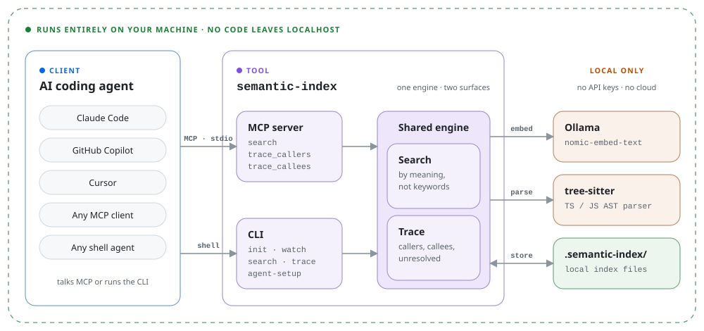

# agent-code-search

Local semantic code search and call-graph tracing for AI coding agents, served as a CLI and an MCP server. Your code never leaves your machine.

<picture>
  <source media="(prefers-color-scheme: dark)" srcset="docs/assets/architecture-dark.svg">
  
</picture>

- **`search "<query>"`** finds code by meaning, not keywords.
- **`trace callers|callees <name>`** walks a real AST call graph, including arrow functions, namespace imports and `this.method()`. Calls the tool can't resolve are listed as `unresolved`, never silently dropped.

TypeScript and JavaScript only (`.ts`, `.tsx`, `.js`, `.jsx`).

## Quickstart

Requires Node.js 20+ and [Ollama](https://ollama.com).

```bash
git clone https://github.com/arifbazli/agent-code-search && cd agent-code-search
npm install && npm run build && npm link
ollama pull nomic-embed-text

cd /path/to/your/project
semantic-index init                          # index this directory
semantic-index search "who validates a login"
semantic-index trace callers login           # works without init
```

Add `--json` to `search` or `trace` for machine-readable output. `semantic-index watch` keeps the index current while you edit.

## Connect your agent

| Agent | Setup |
|---|---|
| Claude Code | `claude mcp add semantic-index -- semantic-index mcp` |
| Claude Desktop, Cursor | `"semantic-index": { "command": "semantic-index", "args": ["mcp", "--dir", "/path/to/project"] }` under `mcpServers` |
| VS Code | `"semantic-index": { "type": "stdio", "command": "semantic-index", "args": ["mcp", "--dir", "${workspaceFolder}"] }` under `servers` in `.vscode/mcp.json` |
| Shell-only agents | `semantic-index agent-setup` writes `CLAUDE.md`, `AGENTS.md` and `.github/copilot-instructions.md` |

The MCP server exposes `search`, `trace_callers` and `trace_callees`. Run `init` first for `search`.

## Example

```text
$ semantic-index search "look up an item by id" --top-k 1
0.643  getItemById  service.ts:1-3
    export function getItemById(id: string) {
      return ItemModel.findOne({ where: { id } });
    }

$ semantic-index trace callees getItemById
No callees found for "getItemById".

Unresolved calls (not followed):
  ItemModel.findOne  in getItemById  service.ts:2
```

For `trace callers`, the unresolved list shows *possible* callers: call sites such as `this.repo.save` whose final name matches the target.

## Limits

- Brute-force vector search with no ANN index. Tested on codebases of about 30 files and 130 functions.
- Call resolution is name- and import-based. Dynamic dispatch, higher-order calls and barrel re-exports stay `unresolved`.
- `nomic-embed-text` ranks similar helpers within one file less reliably than unrelated code.
- `watch` re-parses the whole directory on each change and runs only in the foreground.

Design notes: [`docs/ARCHITECTURE.md`](docs/ARCHITECTURE.md).

## Development

```bash
npm run lint && npm test   # type-check + unit tests (what CI runs)
npm run test:e2e           # needs Ollama with nomic-embed-text
```

One e2e test indexes a sibling checkout at `../semantic-code-review` and is skipped when it's missing.

## License

MIT
