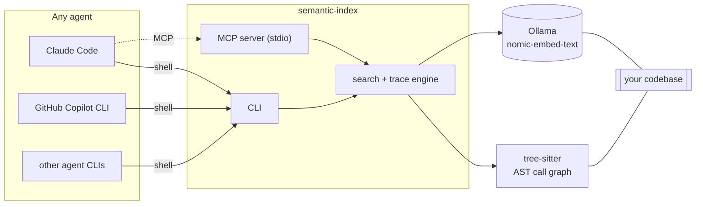

# agent-code-search

Give any coding agent meaning-based search and caller/callee tracing over your codebase, fully local.

The CLI and MCP server share one engine, so an agent that shells out (Claude Code, GitHub Copilot CLI, other agent CLIs) and an agent that speaks MCP natively get the same results. The package and binary are called `semantic-index`.

- `search "<query>"` finds code by meaning using local embeddings (Ollama, `nomic-embed-text`) instead of matching keywords.
- `trace callers|callees <name>` looks up the call graph from a real tree-sitter AST parse, not regex.

## Why

- **Keyword search misses intent.** `grep login` doesn't find `authenticateUser`. Embedding search ranks code by what it does, so "who validates a login" finds it.
- **Regex call tracing misses handlers.** Tools that trace calls with per-language regex patterns, such as [grepai](https://github.com/yoanbernabeu/grepai), are documented to miss arrow-function handlers. This tool parses with `tree-sitter` and resolves identifier calls, `import * as ns` indirection and `this.method()` calls structurally. It records calls it can't resolve instead of dropping them.
- **Your code stays on your machine.** Embeddings come from a local Ollama instance and the index is plain JSON in `.semantic-index/`. Nothing is sent to a cloud service.

This tool finds and ranks relevant code. It doesn't decide whether code is vulnerable or correct. That's a deliberate boundary; see [`docs/ARCHITECTURE.md`](docs/ARCHITECTURE.md).

## Supported languages

TypeScript and JavaScript only for now: `.ts`, `.tsx`, `.js` and `.jsx` files. Other files are ignored. More tree-sitter grammars are on the [roadmap](#roadmap).

## Quickstart

Requires Node.js 20 or newer and [Ollama](https://ollama.com).

```bash
git clone https://github.com/arifbazli/agent-code-search && cd agent-code-search
npm install && npm run build
npm link                                       # puts `semantic-index` on your PATH
ollama pull nomic-embed-text

cd /path/to/your/project
semantic-index init                            # parse + embed + build the call graph for this dir
semantic-index search "who validates a login"  # requires init
semantic-index trace callers login             # does not require init; builds the graph on the fly if needed
semantic-index watch                           # keep the index current while you edit
semantic-index agent-setup --with-subagent     # writes CLAUDE.md, AGENTS.md, .github/copilot-instructions.md
semantic-index mcp                             # same engine, as an MCP server over stdio
```

`search` and `trace` both accept `--json` for machine-readable output. If a function name matches more than one function, `trace` lists the matches and asks you to narrow it with `--file`.

## Connect your agent

Run `semantic-index init` in the project first; the MCP `search` tool needs the index. The server exposes three tools: `search`, `trace_callers` and `trace_callees`.

The MCP server indexes the directory passed with `--dir` and defaults to the directory it was started in. Desktop clients don't start servers in your project folder, so pass an absolute path.

### Claude Code

```bash
cd /path/to/your/project
claude mcp add semantic-index -- semantic-index mcp
```

### Claude Desktop

Add this to `claude_desktop_config.json`:

```json
{
  "mcpServers": {
    "semantic-index": {
      "command": "semantic-index",
      "args": ["mcp", "--dir", "/path/to/your/project"]
    }
  }
}
```

### VS Code (GitHub Copilot agent mode)

Add this to `.vscode/mcp.json` in your project:

```json
{
  "servers": {
    "semantic-index": {
      "type": "stdio",
      "command": "semantic-index",
      "args": ["mcp", "--dir", "${workspaceFolder}"]
    }
  }
}
```

### Cursor

Add this to `.cursor/mcp.json` in your project:

```json
{
  "mcpServers": {
    "semantic-index": {
      "command": "semantic-index",
      "args": ["mcp", "--dir", "/path/to/your/project"]
    }
  }
}
```

### Shell-only agents

Agents without MCP support can call the CLI directly. `agent-setup` writes instruction files telling them when and how to do that:

```bash
semantic-index agent-setup --claude              # CLAUDE.md
semantic-index agent-setup --agents-md           # AGENTS.md (Codex, Pi and other AGENTS.md readers)
semantic-index agent-setup --copilot             # .github/copilot-instructions.md
semantic-index agent-setup --with-subagent       # also .claude/agents/code-navigator.md
```

With no flags, it writes `CLAUDE.md`, `AGENTS.md` and `.github/copilot-instructions.md`.

## Example session

This is real output from the `tests/fixtures/interprocedural` fixture, an Express route whose inline handler calls a service function. Absolute paths are shortened.

```text
$ semantic-index init
Indexing .../interprocedural ...
Scanned 2 files, found 3 functions.
Embedded 3 chunks (reused 0 unchanged, removed 0).

$ semantic-index search "look up an item by id"
0.643  getItemById  .../service.ts:1-3
    export function getItemById(id: string) {
      return ItemModel.findOne({ where: { id } });
    }

0.500  <anonymous:10>  .../routes.ts:10-10
      getItemById(id).then((item: unknown) => res.json(item));

0.489  <anonymous:8>  .../routes.ts:8-11
    router.get("/items/:id", function (req, res) {
      const id = req.params.id;
      getItemById(id).then((item: unknown) => res.json(item));
    });

$ semantic-index trace callers getItemById
<anonymous:8>  .../routes.ts:8-11
```

The caller is an unnamed route handler. It appears as `<anonymous:8>`, named after its start line, because a call made from inside a callback would otherwise be invisible to the call graph.

Calls the resolver can't follow, such as methods on `node_modules` objects, are kept in the `unresolved` list in `.semantic-index/callgraph.json`:

```json
[
  { "callerId": ".../routes.ts#<anonymous:10>@10", "calleeText": "res.json", "line": 10 },
  { "callerId": ".../routes.ts#<anonymous:8>@8", "calleeText": "getItemById(id).then", "line": 10 },
  { "callerId": ".../service.ts#getItemById@1", "calleeText": "ItemModel.findOne", "line": 2 }
]
```

`trace` output doesn't include this list yet; for now, read it from `callgraph.json`. Showing it in `trace` is on the [roadmap](#roadmap).

## Architecture



Both surfaces call the same engine code (`src/search/engine.ts`, `src/trace/engine.ts`). [`docs/ARCHITECTURE.md`](docs/ARCHITECTURE.md) has the full design rationale. It includes two real bugs found and fixed while validating against ground-truth fixtures: anonymous functions were invisible as callers, and calls inside nested callbacks were counted twice.

## Known limits

- **TypeScript and JavaScript only.** Other languages aren't indexed.
- **Small codebases only so far.** The largest codebase tested is this tool's own `src/` (31 files, 131 functions, 135 embedded chunks). Larger repositories should work but haven't been measured.
- **No vector index.** Search scans every stored chunk; there's no ANN structure. Embeddings are normalized to unit length when the index is built, so each query does one dot product per chunk instead of a full cosine calculation.
- **Call resolution uses names and imports, not points-to analysis.** Dynamic dispatch, higher-order calls and barrel re-exports end up in `unresolved` rather than being resolved. They're never silently dropped.
- **Weaker ranking within one file.** `nomic-embed-text` separates unrelated domains cleanly (scores above 0.5) but is measurably worse at picking one helper out of many similar ones in the same file. Search adds a small boost for word overlap between the function name and the query (`src/search/lexical.ts`). That helps, but the model limitation remains. See `tests/e2e/search.e2e.test.ts`.
- **No daemon.** `watch` re-parses the whole directory on each change (it re-embeds only what changed) and stops indexing when the process exits.
- **Files over 200 KB are skipped by default.** Change `scan.maxFileBytes` in `.semantic-index/config.yaml` to adjust this.

## Contributing and tests

```bash
npm run lint       # type-check (tsc --noEmit)
npm run build
npm test           # unit tests only; no external dependencies; this is what CI runs
npm run test:e2e   # builds first, then runs the e2e suite against a real Ollama
```

- **Unit tests** have no external dependencies and use no mocks.
- **E2e tests** need Ollama running on `http://localhost:11434` with `nomic-embed-text` pulled. They make real embedding calls and start the built CLI as an actual MCP subprocess.
- **One e2e test needs a sibling repository.** The embedding-quality check indexes `../semantic-code-review/src/taint`. Clone that repository next to this one to run it; otherwise the test is skipped with a message saying why.

CI runs lint, build and unit tests on every pull request and on every push to `master`.

## Roadmap

- An ANN vector index (for example `sqlite-vec` or LanceDB) instead of the brute-force scan.
- More tree-sitter grammars: Python, Go, Java, C# and others.
- Showing the `unresolved` call list in `trace` and MCP output.
- A daemon mode that keeps the index current without a foreground `watch`.
- Publishing to npm (`npx semantic-index`) and to MCP server registries.

## License

MIT
